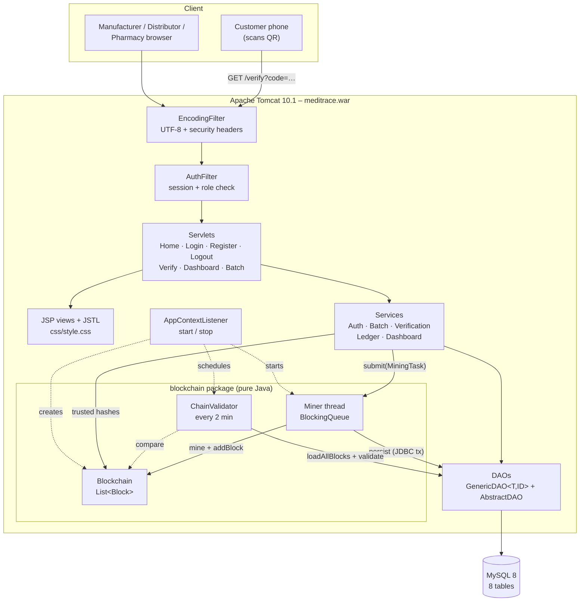
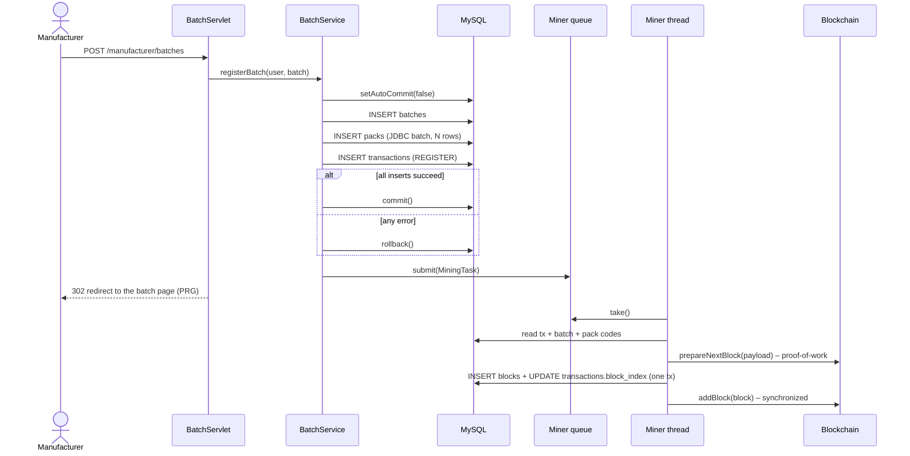
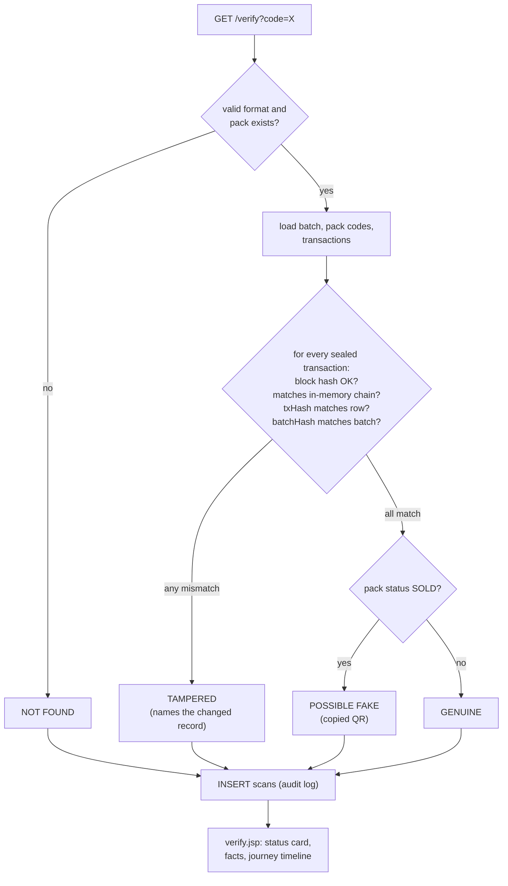

# MediTrace – architecture

## Layers

## Batch registration (JDBC transaction + background mining)

## Customer verification

## Threads at run time

| Thread | Created by | Job |
|---|---|---|
| Tomcat request threads | Tomcat | Handle HTTP requests (many at once) |
| `meditrace-miner` | `AppContextListener` → `Miner.start()` | Single consumer of the `BlockingQueue`; mines and stores blocks |
| `meditrace-chain-validator` | `ChainValidator.start()` | Re-validates the whole chain from MySQL every 120 s |

Shared state:
- the `Blockchain` uses `synchronized` methods and hands out snapshot copies;
- the latest `ValidationReport` is a `volatile` field;
- the login-failure counters are a `ConcurrentHashMap`.
