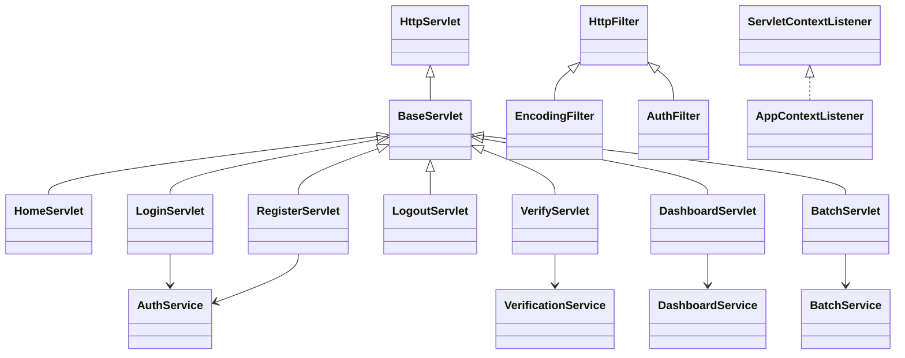

# MediTrace – class diagram

The main classes and the Core Java concepts they show. Getters, setters and most fields are omitted for readability.

```mermaid
classDiagram
    direction TB

    class User {
        <<abstract>>
        -long userId
        -String username
        -String company
        -String city
        +getRole()* Role
        +getResponsibility()* String
        +getJourneyLabel()* String
        +canRegisterBatch() boolean
        +canSellToCustomer() boolean
        +getDisplayName() String
    }
    class Manufacturer {
        +getRole() Role
        +getJourneyLabel() String
        +canRegisterBatch() boolean
    }
    class Distributor {
        +getRole() Role
        +getJourneyLabel() String
    }
    class Pharmacy {
        +getRole() Role
        +getJourneyLabel() String
        +canSellToCustomer() boolean
    }
    class Role {
        <<enumeration>>
        MANUFACTURER
        DISTRIBUTOR
        PHARMACY
        +getSlug() String
        +getAreaColour() String
    }
    class UserFactory {
        +create(Role)$ User
    }
    User <|-- Manufacturer
    User <|-- Distributor
    User <|-- Pharmacy
    User --> Role
    UserFactory ..> User : creates

    class Hashable {
        <<interface>>
        +computeHash() String
    }
    class Verifiable {
        <<interface>>
        +verify() boolean
    }
    class Block {
        -int index
        -String prevHash
        -long timestamp
        -String dataJson
        -long nonce
        -String hash
        +mine(int difficulty)
        +computeHash() String
        +verify() boolean
    }
    class Blockchain {
        -List~Block~ chain
        -Map~String,Block~ blocksByHash
        +prepareNextBlock(String) Block
        +addBlock(Block) synchronized
        +validate(List~Block~, int)$ ValidationReport
        +verify() boolean
    }
    class Batch {
        +computeHash() String
    }
    class Transaction {
        +computeHash() String
    }
    Hashable <|.. Block
    Verifiable <|.. Block
    Verifiable <|.. Blockchain
    Hashable <|.. Batch
    Hashable <|.. Transaction
    Blockchain "1" o-- "*" Block

    class Miner {
        -BlockingQueue~MiningTask~ queue
        +submit(MiningTask) boolean
        +run()
    }
    class ChainValidator {
        -ScheduledExecutorService scheduler
        -volatile ValidationReport lastReport
        +run()
        +validateNow() ValidationReport
    }
    class LedgerGateway {
        <<interface>>
        +buildPayload(MiningTask) String
        +persist(Block, MiningTask)
        +loadAllBlocks() List~Block~
    }
    class LedgerService
    class MiningTask {
        <<record>>
        long txId
        Instant queuedAt
    }
    Runnable <|.. Miner
    Runnable <|.. ChainValidator
    LedgerGateway <|.. LedgerService
    Miner --> Blockchain
    Miner --> LedgerGateway
    Miner ..> MiningTask
    ChainValidator --> LedgerGateway

    class GenericDAO {
        <<interface T, ID>>
        +findById(ID) Optional~T~
        +findAll() List~T~
        +save(T) ID
        +count() long
        +update(T) boolean
        +delete(ID) boolean
    }
    class AbstractDAO {
        <<abstract>>
        #queryList(String, RowMapper~R~, Object...) List~R~
        #insertAndGetKey(Connection, String, Object...) long
    }
    class RowMapper~T~ {
        <<interface>>
        +map(ResultSet) T
    }
    class DBConnection {
        <<singleton>>
        +getInstance()$ DBConnection
        +getConnection() Connection
    }
    AbstractDAO <|-- UserDAO
    AbstractDAO <|-- BatchDAO
    AbstractDAO <|-- PackDAO
    AbstractDAO <|-- BlockDAO
    AbstractDAO <|-- TransactionDAO
    AbstractDAO <|-- ScanDAO
    AbstractDAO <|-- ReportDAO
    AbstractDAO <|-- RecallDAO
    GenericDAO <|.. UserDAO
    GenericDAO <|.. BlockDAO
    AbstractDAO ..> DBConnection
    AbstractDAO ..> RowMapper

    class MediTraceException {
        <<checked>>
    }
    MediTraceException <|-- DataAccessException
    MediTraceException <|-- TamperDetectedException
    MediTraceException <|-- ProductNotFoundException
    MediTraceException <|-- UnauthorizedException
    MediTraceException <|-- AuthenticationException
```

> All eight DAOs implement `GenericDAO`; only two arrows are drawn to keep the diagram readable.

## Servlet layer

