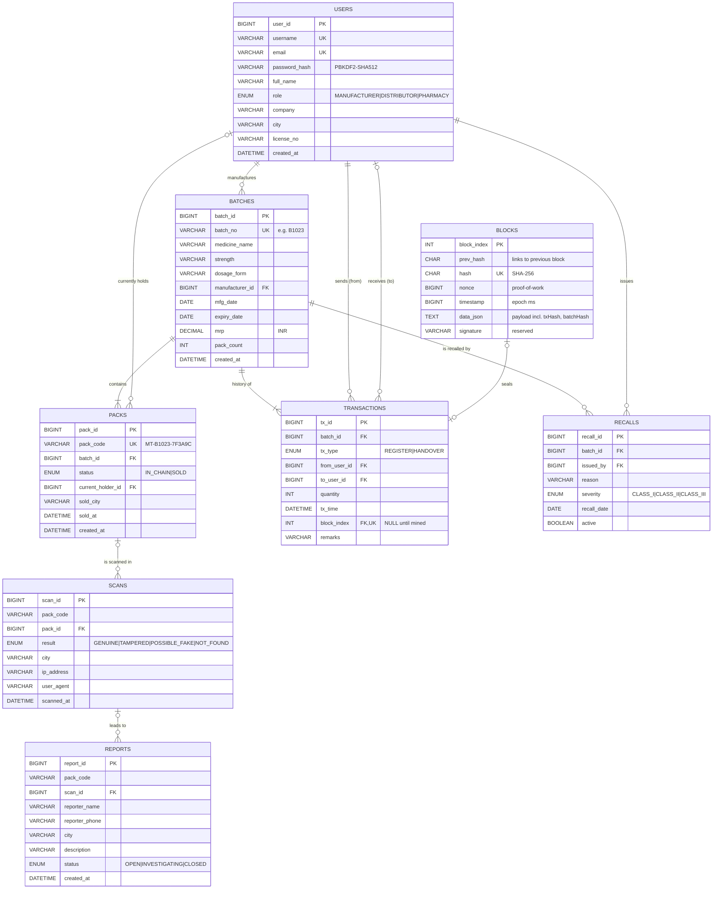

# MediTrace – ER diagram

Rendered automatically by GitHub (Mermaid). Source of truth: [`sql/schema.sql`](../sql/schema.sql).

## Design notes

- **One `users` table with a `role` column** rather than three tables. The three roles share the same columns, and the Java side still gets proper subclasses through `UserFactory`.
- **`packs` is one row per physical pack.** That is what makes a copied QR detectable: a second scan of a code whose status is already `SOLD`.
- **`transactions.block_index` is nullable and UNIQUE.** A row is written immediately, then the Miner thread links it to exactly one block.
- **`scans.pack_code` has no foreign key**, so scans of unknown (fake) codes are recorded too.
- **`blocks.data_json` is `TEXT`, not `JSON`.** MySQL would re-format a JSON column and change the hash.
- **Deletes are restricted** (no `ON DELETE CASCADE` on ledger tables). Supply-chain history must never disappear silently.
